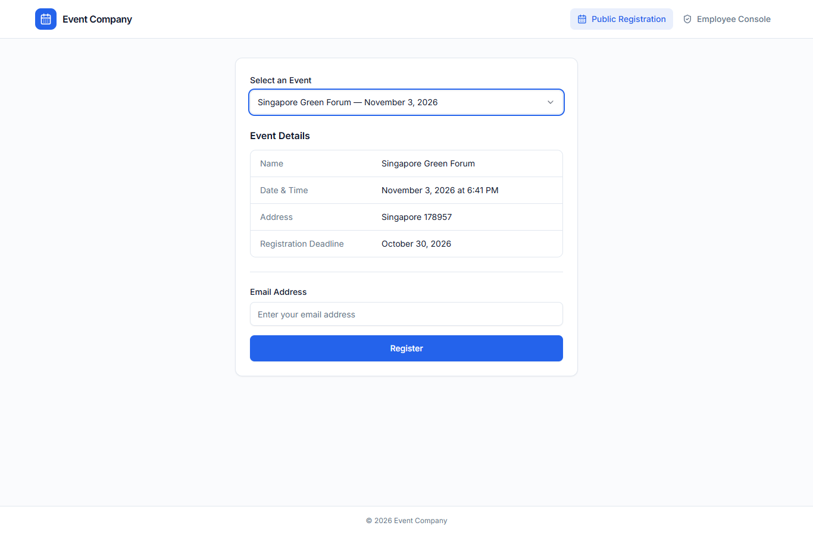
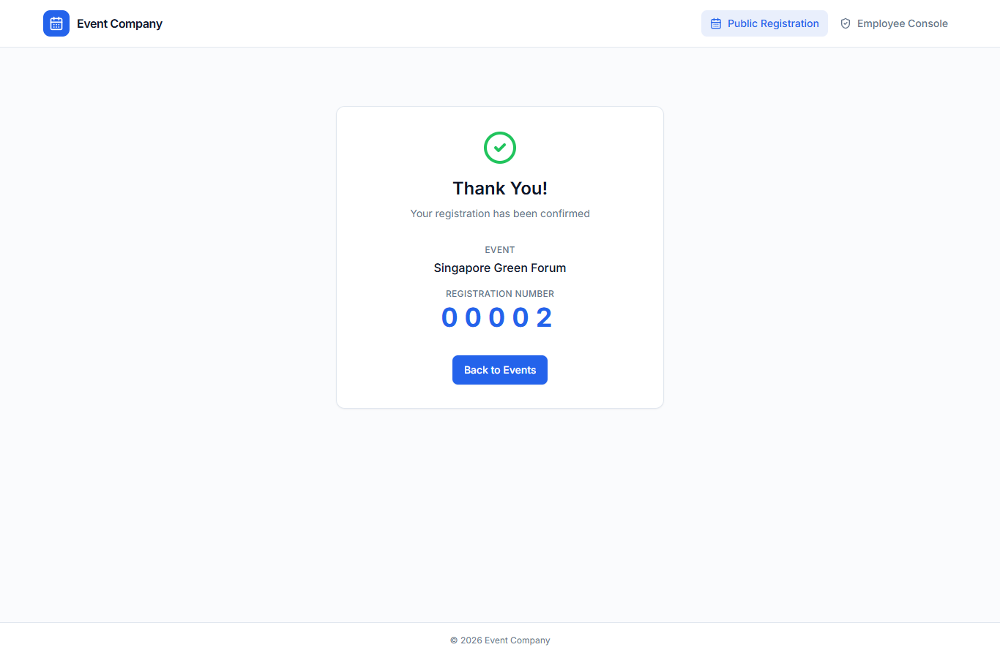
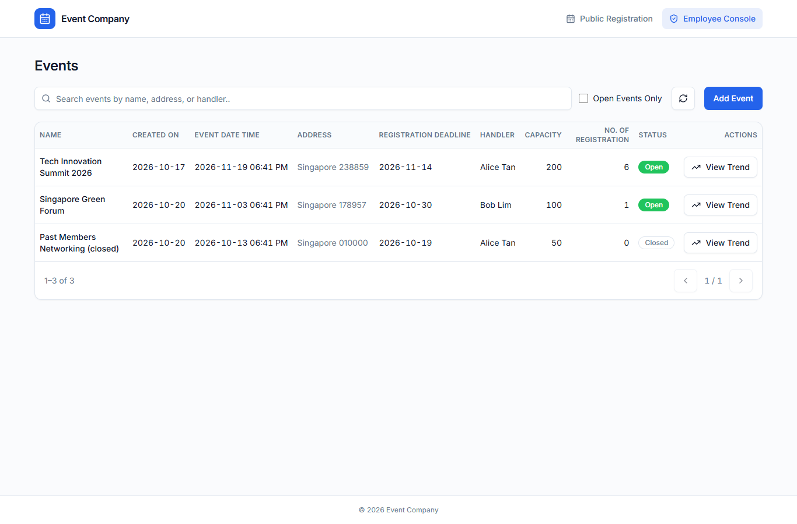
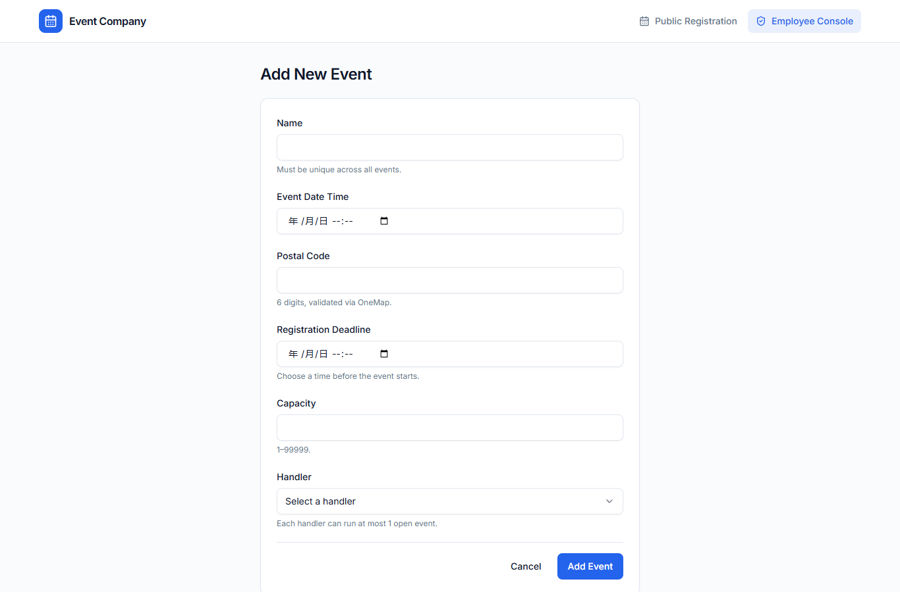
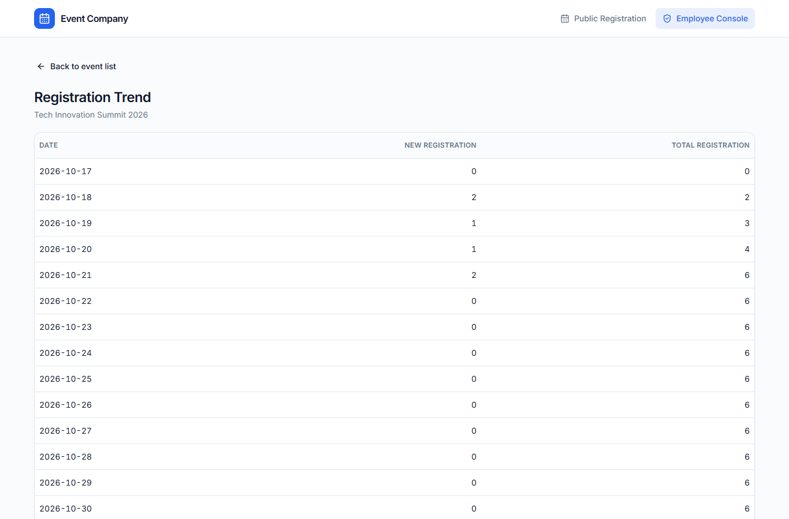
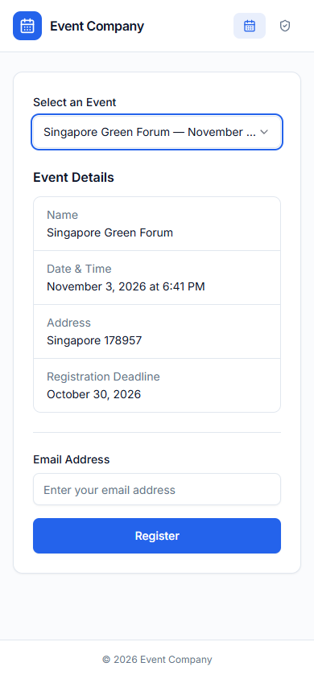

# Event Registration System

A full-stack event registration platform with two interfaces:

* **Employee console** – browse, search, filter and create events, view per-event registration trends.
* **Public registration** – a single-page experience where the public picks an open event from a dropdown, registers with their email and receives a 5-digit running registration number.

**Live demo:** <https://events.myminisite.work> — running against MySQL, seeded with the sample data described below. Nothing is mocked, so anything created there is real and persists.

The system is built as a monorepo with two services:

| Service | Tech | Port |
| --- | --- | --- |
| `server/` | Express 4 · TypeScript · Sequelize (MySQL by default, SQLite for local convenience) · Winston · Jest | `8000` |
| `client/` | React 18 · React Router 6 · shadcn/ui (Tailwind CSS) · TanStack Query · Zod · Axios · Vite | `8001` |

## Tech stack

* **General** – TypeScript everywhere, `axios` as the HTTP client
* **Backend** – Express.js, MySQL via Sequelize, Winston for logging, Jest + Supertest for tests
* **Frontend** – React, React Router, **shadcn/ui on Tailwind CSS**, **TanStack Query** for server state and **Zod** for runtime response validation. shadcn/ui ships unstyled primitives rather than a themed widget set, so it needs a CSS layer - Tailwind provides it. `axios` is the HTTP client; TanStack Query sits *on top of* it rather than replacing it, since Query manages caching, retries and loading state while the requests themselves still go through axios.

## Repository layout

```
.
├── README.md
├── docker-compose.yml        # db + api + web (+ a one-shot seed job)
├── .env.example              # compose-level configuration
├── package.json              # root scripts (lint / typecheck / test / build) + tooling
├── eslint.config.mjs         # ESLint (flat config) for both services
├── .prettierrc
├── .husky/                   # pre-commit (lint-staged) + commit-msg (commitlint)
├── .github/workflows/ci.yml  # lint + typecheck + tests + build, plus a separate e2e job
├── deploy/                   # reverse proxy site + deployment runbook
├── e2e/                      # Playwright suite (boots the stack itself)
├── screenshots/              # Screenshots of the running system
├── server/
│   ├── Dockerfile            # build / seed / runtime stages
│   ├── src/
│   │   ├── config/           # Env loader, logger, Sequelize instance
│   │   ├── models/           # Handler, Event, Registration (+ associations)
│   │   ├── services/         # Business logic + OneMap integration
│   │   ├── validators/       # express-validator chains
│   │   ├── middleware/       # Error handler, request logger + id, async wrapper
│   │   ├── routes/           # /api/admin and /api/public routers
│   │   ├── utils/            # Date, error, SQL and cache helpers
│   │   ├── tests/            # Jest suite (in-memory SQLite)
│   │   ├── app.ts            # Express app (used by tests via supertest)
│   │   ├── index.ts          # Process entry point
│   │   └── seed.ts           # Seeds employees (handlers) and optional demo data
│   ├── jest.config.js
│   ├── tsconfig.json
│   └── package.json
└── client/
    ├── Dockerfile            # Vite build + unprivileged nginx runtime
    ├── nginx.conf            # serves the bundle, proxies /api to the API (listens on 8080)
    ├── src/
    │   ├── api/              # Axios client, zod schemas, TanStack Query hooks
    │   ├── components/ui/    # shadcn/ui primitives
    │   ├── lib/              # cn() helper, debounce hook
    │   ├── pages/            # PublicEvent, AdminEvents, CreateEvent, EventTrend
    │   ├── utils/            # Date / format helpers
    │   ├── App.tsx           # Router + header
    │   └── main.tsx
    ├── vite.config.ts
    ├── tsconfig.json
    └── package.json
```

## Tooling

Everything can be driven from the repo root:

```bash
npm install        # installs root tooling (husky, eslint, prettier, commitlint)
npm run install:all
npm run lint       # ESLint across server + client
npm run typecheck  # tsc --noEmit for both services
npm test           # server Jest suite
npm run build      # client production build + server tsc
```

Commits are conventional-commitlint checked, and pre-commit runs ESLint + Prettier on the staged files. GitHub Actions runs lint, typecheck, tests and builds on every push to `main`.

## Getting started

### 1. Database

The included `docker-compose.yml` starts a MySQL 8 container:

```bash
cp .env.example .env      # the compose file reads credentials from here
docker compose up -d db
```

That publishes MySQL on `127.0.0.1:3306` with database `event_registration` and the user/password from `.env` (`event_app` / `eventapp` by default).

No Docker? Any MySQL 8 or MariaDB you already run is enough. Create the same database and account by hand, as an admin user (`mysql -u root -p`):

```sql
CREATE DATABASE event_registration CHARACTER SET utf8mb4 COLLATE utf8mb4_unicode_ci;
CREATE USER 'event_app'@'%' IDENTIFIED BY 'eventapp';
CREATE USER 'event_app'@'localhost' IDENTIFIED BY 'eventapp';
GRANT ALL PRIVILEGES ON event_registration.* TO 'event_app'@'%';
GRANT ALL PRIVILEGES ON event_registration.* TO 'event_app'@'localhost';
```

Both host entries are created on purpose: MySQL matches `'event_app'@'localhost'` before `'event_app'@'%'`, so an account that only exists as `%` can still be refused on a local socket.

> Do not want MySQL at all? Set `DB_DIALECT=sqlite` in `server/.env` (step 2) and skip this step — the schema is created on boot and `DB_STORAGE` points at a file. Handy for a quick look, but MySQL is what the deployment and the test contract are written against.

> The test suite uses an in-memory SQLite database, so you do not need MySQL installed to run tests.

> **Event names are unique.** The brief requires it, so `events.name` carries a unique index and `sequelize.sync()` creates it on a fresh database. Pointing the app at a database that already has an `events` table will not add it: Sequelize only applies model changes on boot when `SYNC_ALTER=true`, and that defaults to `false` because a boot must never reshape production tables on its own. Apply it once by hand:
>
> ```sql
> ALTER TABLE events ADD UNIQUE INDEX events_name_unique (name);
> ```
>
> Check it took: `SHOW INDEX FROM events WHERE Key_name = 'events_name_unique';`

### 2. Configure environment

```bash
cd server
cp .env.example .env
```

The defaults point at the database from step 1 — `event_app` / `eventapp` on `127.0.0.1:3306` — so a plain copy connects without editing. Change it only if you created a different account or your MySQL lives somewhere else.

The most relevant variables are:

| Variable | Default | Purpose |
| --- | --- | --- |
| `PORT` | `8000` | API port |
| `DB_DIALECT` | `mysql` | Set to `sqlite` for local convenience |
| `DB_HOST/PORT/NAME/USER/PASSWORD` | – | MySQL connection |
| `ONEMAP_TOKEN` / `ONEMAP_EMAIL` / `ONEMAP_PASSWORD` | _empty_ | Singapore OneMap credentials. Either a pre-issued access token (valid three days) or the account to log in with — the token wins when both are set. Register free at <https://www.onemap.gov.sg/apidocs/register>. **Required to create an event**: with none of them set, the API refuses with a `500` and logs an error at boot, because it has no way to validate a postal code. |
| `CORS_ORIGIN` | `http://localhost:8001` | Comma separated list of allowed origins |
| `PAGE_SIZE` | `10` | Admin list page size |
| `CACHE_TTL_MS` | `10000` (`0` when `NODE_ENV=test`) | How long an in-process read cache may serve a response, in milliseconds. `0` disables the cache. |
| `TRUST_PROXY` | `false` | Set to `true` only when the API runs behind Nginx / a load balancer (see note below) |

> **`TRUST_PROXY`** – leave it `false` unless the API sits behind Nginx or a load balancer. When it is `true`, one hop of `X-Forwarded-For` is trusted, so `req.ip` and the rate limiter see the real client. Turning it on while the API is directly reachable lets a client choose its own IP and slip past the rate limiter.

### 3. Install dependencies & seed the database

```bash
cd server && npm install
cd ../client && npm install

# Seed employees (handlers). With --demo you also get sample events + registrations.
cd ../server && npm run seed
npm run seed -- --demo
```

The seed script is **idempotent** for employees (it uses `findOrCreate` on email), so re-running it is safe.

Without OneMap credentials `npm run seed -- --demo` stops at the first event: every event needs an address OneMap returned, so there is nothing to store. Set `ONEMAP_TOKEN` (or `ONEMAP_EMAIL` + `ONEMAP_PASSWORD`) before seeding. The test suite is unaffected — it stands up a stub OneMap instead of reaching for the network.

Creating an event by hand needs a postal code OneMap knows — `238859`, `178957` and `049213` all resolve. A made-up six-digit code is refused with a `421`, which is the whole point of the requirement.

### 4. Run the system

In two terminals:

```bash
# terminal 1 – API
cd server && npm run dev
# → API listening on http://localhost:8000

# terminal 2 – Web
cd client && npm run dev
# → http://localhost:8001
```

Or run the whole thing in containers:

```bash
docker compose up -d --build        # db + api + web
docker compose run --rm seed --demo # seed inside the stack
# → http://localhost:8081
```

That is the same `docker-compose.yml` used on a server; `deploy/README.md` covers the reverse proxy, TLS and DNS.

Both containers run as an unprivileged user. The API image drops to the `node` user; the web image uses the `nginx-unprivileged` variant, which is why its server block listens on **8080** instead of 80 — a non-root process cannot bind a port below 1024. That number is internal only: compose still publishes `8081` on the host, and Caddy in front of it never learns the difference.

## API surface

All responses are JSON. Status codes follow the documented contract:

* `200` – success
* `421` – validation error (the request payload is malformed or violates a per-field rule)
* `400` – expected client error (e.g. business rule violation, unknown record)
* `500` – unexpected / server error

Those four are the only statuses a defined endpoint returns, and the line between `421` and `400` is deliberate: `421` means a value the caller sent is wrong (missing field, bad email, postal code that is not six digits or that OneMap does not know, `page` outside `1…1000000`), while `400` means the request was well formed but the business said no (duplicate name, handler already on an open event, event closed or full, unknown uuid). The client relies on that split — `421` pins red text to the offending input, `400` shows a banner above the form.

Two statuses worth knowing about:

* An unmatched route answers `404`. The brief does not cover it; reporting a URL that does not exist as a `400` would be worse than the honest answer.
* `304` is deliberately impossible. Express's ETag is switched off in `app.ts`: a conditional GET would otherwise come back `304` with no body, which is neither one of the four nor something an automated checker can assert on. Repeat reads are cached in-process and say so in `X-Cache` instead of changing the status code.

Cached read endpoints also return `X-Cache: HIT|MISS`, so the in-process read cache (see `server/src/utils/cache.ts`) is observable from the outside instead of being taken on faith.

Every response carries `X-Request-Id`: whatever the caller sent in that header (if it is 8–64 URL-safe characters), otherwise a generated uuid. The same id is stamped on every log line the request produced, including lines written deep inside a service, so a reported failure can be traced from the response back to what the server actually did. It is set before the handler runs, which means error responses carry it too — the case where it matters most.

### Public API (`/api/public`)

| Method | Endpoint | Body | Response |
| --- | --- | --- | --- |
| `GET` | `/api/public/events` | – | Array of open events: `[{ uuid, name, dateTime, address, deadline }]` |
| `POST` | `/api/public/register` | `{ eventUuid, emailAddress }` | `{ registrationNo }` (5-digit, zero-padded) |

### Admin API (`/api/admin`)

| Method | Endpoint | Notes |
| --- | --- | --- |
| `GET` | `/api/admin/events` | Query: `page` (default `1`), `search`, `open` (`true`/`1`). Returns `{ total, events: [{ uuid, createdAt, name, dateTime, address, deadline, capacity, registrationCount, handler: { uuid, name } }] }` |
| `POST` | `/api/admin/events` | Body: `{ name, dateTime, postalCode, deadline, capacity, handlerUuid }`. Returns `200` with `null` body. |
| `GET` | `/api/admin/events/:uuid` | Supplementary endpoint used by the trend page. |
| `POST` | `/api/admin/events/:uuid/trend` | Returns array of `{ date, registrationCount, newRegistrationCount }` for every day from creation to deadline (inclusive). |
| `GET` | `/api/admin/handlers` | Employees (used by the create-event form). |

### Validation examples

* Missing required field → `421 { message: "Some of the information you entered is not valid. Please check the highlighted fields and try again.", errors: [{ field, message }] }`
* Postal code OneMap has no record of → `421`, `errors: [{ field: "postalCode", message: "OneMap could not find an address for this postal code. Please check it." }]`
* Postal code that is not six digits → `421`, `errors: [{ field: "postalCode", message: "Please enter a 6-digit Singapore postal code." }]`
* OneMap unreachable (timeout, rejected token, 5xx) → `500 { message: "We could not check this postal code with OneMap just now. Please try again in a moment." }` — nothing is stored
* Handler already running an open event → `400 { message: "Handler <name> is already handling an open event. Each handler can only run one open event at a time." }`
* Unknown eventUuid on trend → `400 { message: "This event could not be found. It may have been removed." }`
* Registering for a closed event → `400 { message: "Registration for this event has closed because the deadline has passed." }`

Every message in a response is written for the person using the app: a full sentence, no field names in camelCase, no status codes. The client renders the API's `message` verbatim rather than re-phrasing it, so the wording lives in exactly one place. `field` in the `errors` array is the exception - it stays the raw API field name, because its only job is to tell the form which input to highlight.

## Tests

```bash
cd server && npm test        # unit + integration (no database to install)
npm run test:e2e             # end-to-end, from the repository root
```

### Unit & integration

Jest runs against an in-memory SQLite database (so no MySQL is required). The suite covers all five user stories plus the supporting endpoints, the OneMap integration (axios fully mocked — no network access) and the date utilities. The API-level suites stub the OneMap lookup in `src/tests/setupFiles.ts`; `onemapService.test.ts` unmocks it and exercises the real client.

Latest run (on this commit):

```
Test Suites: 15 passed, 15 total
Tests:       135 passed, 135 total
Statements:  95.00%
Branches:    72.10%
Functions:   95.83%
Lines:       95.34%
```

The suite is held to a coverage floor of 50%. All four metrics clear that bar, and `jest.config.js` enforces a stricter gate (85/60/85/85) so a future change cannot silently regress the suite.

| Suite | What it covers |
| --- | --- |
| `adminEvents.test.ts` | Story 1 & 2 — pagination, search, `open` filter, creation, every validation and business-rule failure |
| `publicEvents.test.ts` | Story 3 & 4 — open-event listing, 5-digit allocation, duplicate email, capacity and deadline limits |
| `trend.test.ts` | Story 5 — cumulative daily buckets, boundary dates, unknown event |
| `onemapService.test.ts` | Token caching, search hit/miss, unknown postal code rejected on the field, OneMap outage and missing credentials both refused as a `500` |
| `dateUtils.test.ts` | Every accepted input format plus the rejection paths |
| `eventLimits.test.ts` | `capacity` ceiling (99999, because registration numbers are 5 digits) and the `page` ceiling |
| `eventCreationRules.test.ts` | Duplicate event name rejected with the same message from both the pre-check and the unique index; one-open-event-per-handler, including the "closed or full frees the handler" cases |
| `cache.test.ts` | The read-through cache in isolation: hit/miss, expiry, errors are never stored, copies are handed out, the entry cap evicts the oldest |
| `cacheHeaders.test.ts` | The cache over HTTP: `X-Cache` reports MISS then HIT, each filter combination gets its own entry, and creating an event or registering clears it |
| `registrationRules.test.ts` | Duplicate email wins over capacity/deadline; email normalisation; concurrent collision |
| `registrationUniqueConflict.test.ts` | MySQL-shaped `UniqueConstraintError` — proves the email-vs-number distinction works outside SQLite |
| `logSafe.test.ts` | Control-character stripping and truncation; a `%0a` URL does not break the request |
| `requestContext.test.ts` | Request id: generated when absent, reused when sane, replaced when it could forge a log line; the id is stamped on log records and survives an await |
| `apiContract.test.ts` | Exact response key sets for all five endpoints, plus malformed-JSON handling |
| `trendRange.test.ts` | Trend date range runs from creation date to deadline with no gaps |

### End-to-end

`e2e/` drives the real browser against the real production bundle: pick an event, register, read the number off the confirmation, then check that the admin list count moved and that the trend page shows the registration on the right day. It also asserts that a duplicate event name is refused in the form and that nothing overflows at 320px.

Playwright starts both halves itself — the API against a throwaway SQLite file, the client through `vite preview`, which forwards `/api` the same way nginx does. It also stands up a stub OneMap on a random local port, because creating an event now requires a validated address. No Docker, no MySQL, no OneMap account and no outbound request: `npm run test:e2e` on a clean clone is the whole setup (after `npx playwright install chromium`).

The specs are serial on purpose. They share one seeded database, and two of them assert on state an earlier one created; running them in parallel would turn those assertions into timing tests. CI runs this as a separate job so the fast unit job doesn't wait for a browser.

## Design decisions & assumptions

* **Postal code validation** – The brief says the postal code "must be validated against OneMap API", so there is exactly one way an event gets created: OneMap returned an address for that code. A code OneMap does not know is a `421` pinned to the `postalCode` field, and a OneMap outage is a `500` with a sentence saying the failure is ours — neither path stores an address nobody verified. No credentials is the same `500`: without them the system cannot honour the requirement at all, so it refuses and logs an error at boot rather than quietly accepting whatever six digits it is given.

  A consequence worth knowing before pointing an automated test at a running instance: a made-up code is *correctly refused*. Use a postal code OneMap actually has — `238859` (The Paragon), `178957`, `049213` all resolve, and the demo seed uses them. A test that posts `123456` and expects `200` is asserting behaviour the brief does not ask for. The suites in this repository never depend on a third party: Jest stubs the lookup in `src/tests/setupFiles.ts`, and the E2E runner boots a stub OneMap on a random local port.
* **OneMap credentials** – Two shapes are accepted: `ONEMAP_EMAIL` + `ONEMAP_PASSWORD`, which log in on first use and cache the token for three days, or `ONEMAP_TOKEN`, a pre-issued token that skips the login round trip and keeps the password out of the environment. A rejected token is replaced automatically when an account is available; with a pre-issued token the expiry is printed at boot, so renewal is a scheduled task rather than a surprise. To mint a token:
  `curl -X POST https://www.onemap.gov.sg/api/auth/post/getLoginToken -H 'content-type: application/json' -d '{"email":"...","password":"..."}'`
* **Event name uniqueness** – The brief requires it, so `events.name` carries a unique index and the service pre-checks for a friendlier message. The pre-check is not the guarantee: two concurrent requests can both find nothing, and the index is what actually blocks the second insert, which is why both paths return the same wording. The `uuid` remains the identity for every URL, registration row and foreign key - a name is what people read, not how rows are found.
* **Read cache** – The five read paths (public list, admin list, handler list, event detail, trend) go through a process-local TTL cache (`server/src/utils/cache.ts`, default 10s, `CACHE_TTL_MS`). It is deliberately not Redis: a single container does not need a second service to save a query that takes milliseconds. The trade-off is documented in the module - each instance keeps its own copy, and a write clears only the cache of the instance that served it, so the TTL (not invalidation) is what bounds staleness across instances. Every write clears the cache, and responses carry `X-Cache: HIT|MISS` so the behaviour is observable.
* **Registration number generation** – A running 5-digit number unique per event. The service counts existing registrations and reuses the next free number, retrying up to 5 times if a concurrent registration took the slot. A unique index on `(eventUuid, registrationNo)` is the final safety net. Because the number is 5 digits, `capacity` is capped at 99999 — the 100000th registration would otherwise produce a 6-digit number and break the format.
* **Concurrency** – Both "one open event per handler" and "capacity is not exceeded" are check-then-write sequences, which are racy on their own. Each is wrapped in a short transaction that takes a row lock (`SELECT ... FOR UPDATE`) on the contended row — the handler row and the event row respectively — so the check and the insert cannot be interleaved. The OneMap HTTP call is deliberately kept outside the transaction so a slow third-party request never holds a lock.
* **Duplicate email per event** – A user cannot register the same email twice for the same event. Returns `400` with a clear message. This is a sensible business rule; the spec does not explicitly require it. The duplicate check runs before the capacity check so that a `capacity: 1` event still reports "already registered" rather than "full".
* **Handler – open event rule** – A handler may handle at most 1 *open* event at a time. Once the event is closed (deadline passed or capacity reached) the handler is free again.
* **Log hygiene** – Every user-supplied value that reaches the logger passes through `logSafe`, which strips control characters and truncates. Without it, a `%0a` in a query string would let a caller forge an extra log line.
* **Request ids** – Each request gets an id (from `X-Request-Id` when the caller supplies a sane one, otherwise a uuid), returned in the same header and stamped on every log line the request produced. It is carried with `AsyncLocalStorage` rather than a parameter, because a logging-only argument has to be threaded through every function that might ever log, and the one place it gets forgotten is the one place you needed it. Outside a request — startup, the seed script — there is no id and the field is simply absent.
* **Offset pagination, not cursor** – The admin list takes `page` and returns `total`, because that is what the brief specifies and what the UI needs: "showing 1–10 of 47" cannot be rendered from a cursor. Cursor pagination earns its complexity on deep pages over large tables; this list is a handful of rows per page with a search box, and `total` is the more useful half of the contract.
* **Rate limiting is in-process** – Two tiers (100/min public, 600/min admin) held in memory. A shared counter would need Redis, which is a second service to run, monitor and pay for; on a single instance the in-memory limiter enforces exactly the same policy. Behind more than one instance the effective limit becomes limit × instances, which is the same trade-off the read cache makes, and the same fix (a shared store) applies to both.
* **No background queue** – The only outbound call is the OneMap postal-code lookup, and its result is written into the event's `address` field, which the response returns. It is part of the request, not a side effect, so moving it off the request would mean answering before the address exists. There is no email, SMS or QR generation to defer. Adding a queue now would be infrastructure with nothing in it.
* **No stored status column** – "Open" is derived (`deadline > now AND registrations < capacity`), computed in one place (`server/src/utils/sql.ts`) and shared by every caller. A stored status would need a state machine to keep it honest — and it would go stale the moment the clock passed a deadline with nobody writing to the row. Derived state cannot be in an illegal state.
* **What this deliberately is not** – No authentication (the brief says so; `/api/admin` is open, which is the largest gap in the system and is called out here rather than left for someone to discover), no cancellation, no waitlist, no check-in, no payments. The only personal data stored is an email address, and it is never written to the logs. Each of those is a feature with its own schema, endpoints and UI, not something to bolt on to a registration form.
* **Trust proxy is off by default** – `TRUST_PROXY` must be enabled explicitly when the API sits behind a reverse proxy. Leaving it on unconditionally would let a directly exposed instance accept a spoofed `X-Forwarded-For` per request and walk straight past the rate limiter.
* **Server state vs UI state** – Component state (`useState`) is only used for things the user is typing. Everything that comes from the API goes through TanStack Query, which owns loading/error states, request de-duplication, race handling on fast page switches, and cache invalidation after writes (creating an event invalidates both the `['admin']` and `['public']` prefixes, so the list and the public dropdown refresh themselves).
* **Runtime contract validation** – Every API response is parsed with a Zod schema (`strict()`, so extra fields fail loudly) and the TypeScript types are inferred from those schemas rather than hand-written. If the backend ever drifts from the documented response shape, the failure happens at the boundary with a precise message instead of as a `undefined` bubbling into a component.
* **Dates** – Inputs are accepted in ISO 8601, `YYYY-MM-DD HH:mm:ss` and `YYYY-MM-DD`. Outputs are ISO 8601 UTC. The MySQL connection uses `timezone: '+08:00'` to make the storage representation deterministic regardless of the host machine's timezone (Singapore context).
* **Status codes** – `421` for any input that fails per-field validation (e.g. missing `name`, invalid email, bad postal code), `400` for business rule violations / unknown resources, `500` for anything unexpected.
* **No authentication** – As specified. The handler model is treated as a "directory" of employees seeded by the deployment script.

## Screenshots

| | |
| --- | --- |
| Public registration |  |
| Thank-you page |  |
| Employee console |  |
| Create event |  |
| Registration trend |  |
| Mobile public page (390px) |  |

The UI follows the agreed mockups - light theme, blue primary, "Event Company" branding and the same set of columns on the events table. Every page is responsive: below `sm` the toolbar stacks, the event detail rows put their label above the value (a fixed-width label on a 320px screen leaves too little room and forces the browser to break words mid-character), and the events table scrolls horizontally inside its card instead of stretching the page. The nav collapses to icons so the brand name still fits at 320px.
